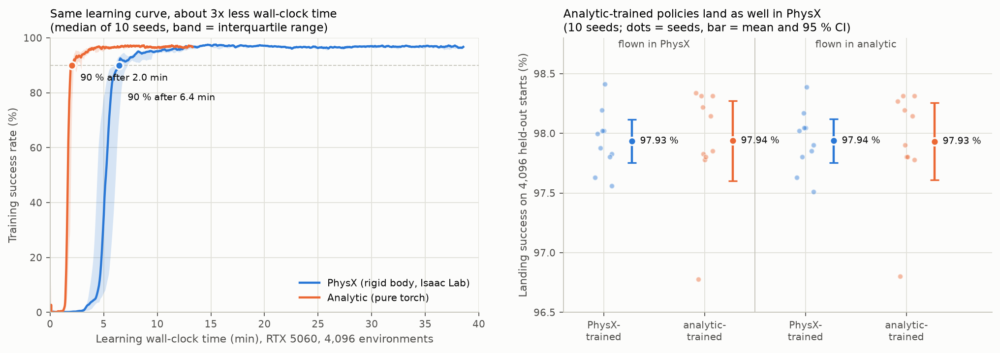
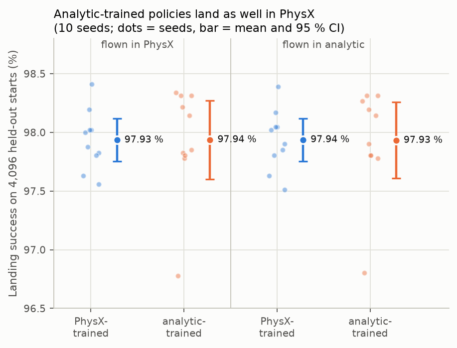
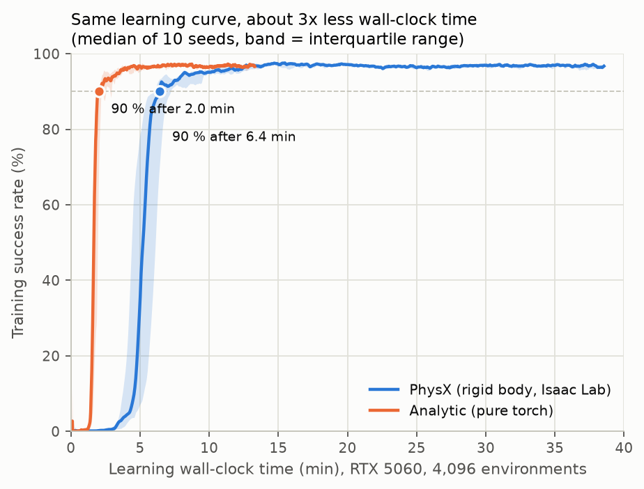

# SpeedVersusFidelityV2

**Can a landing policy trained in a fast analytic simulator land as well in full rigid-body physics, and how much wall-clock time does this save?**

PPO landing policies for an Apollo-class lunar module are trained in two simulators that share everything except the physics: a pure-torch analytic rigid-body model with spring legs, and PhysX rigid-body physics in Isaac Lab.
Each policy is then flown in both simulators on the same 4,096 held-out starts.
This repository holds the analytic plant, the study scripts, the exported results and the figures; it replaces an earlier hopper study ([SpeedVersusFidelity](https://github.com/BalBaZeuR0/SpeedVersusFidelity)).



*Left: training success against learning wall-clock time (median of 10 seeds). Right: landing success of the 20 policies in both simulators (dots = seeds; bar = mean and 95 % CI). Data: `results/`.*

## Overview

| | |
|---|---|
| **Problem** | Fast reduced-order simulators could cut RL training time for propulsive landing, but a policy trained in one may fail in full physics. How large is that transfer gap, and what is the time saved? |
| **Method** | Same scenario (S1 terminal descent), start states, actuators, observation, action, reward and success rule in both simulators; only the plant differs. PPO (rsl_rl), 4,096 environments, 600 iterations, 10 seeds per simulator; each policy flown on 4,096 held-out starts in both simulators; paired statistics (McNemar, Wilson, Welch, TOST with a ±1 point margin). |
| **Simulation / hardware** | Isaac Sim 6.0.1, Isaac Lab 24.2.1, PyTorch 2.11.0, rsl-rl-lib 5.4.1, Python 3.12.3; Ubuntu 24.04.4; NVIDIA GeForce RTX 5060 (8 GB). |
| **Paper** | In preparation. |

### System architecture


The scenario and every slot of the loop (start, actuators, sensors, navigation, reward, metrics) come from LunarSim v2 and are the same for both simulators; the plant binding selects the physics (`plant=analytic_rigid_body` or the PhysX plant). PPO trains in either simulator, and each exported policy is flown on the same held-out starts in both. All GPU work ran on one machine, one job at a time, so the wall-clock times are comparable.

## Selected results

### Result 1: analytic-trained policies land as well in PhysX (no transfer gap)

Over 10 seeds, policies trained in the analytic simulator reach 97.94 % in PhysX, against 97.93 % for policies trained in PhysX itself: a gap of +0.00 points (bootstrap 95 % CI −0.33 to +0.29), equivalent within ±1 point (TOST p < 0.0001). The ±1 point margin was chosen after the runs, about two to four times the seed-to-seed standard deviation (0.25 to 0.47 points). When one policy flies the same start in both simulators, the outcome code is the same for 99.8 % of the starts.



### Result 2: the same learning curve in about a third of the wall-clock time

Training takes 2,318 s in PhysX and 798 s in the analytic simulator (2.9×); 90 % training success is reached after 403 s and 128 s (3.1×, mean of 10 seeds). The speed-up of training is below the speed-up of the environment at 4,096 environments (3.5×), because the PPO update is not faster.



### Result 3: the analytic simulator scales further with the number of environments

With the PPO policy in the loop, the analytic simulator steps 1.6× faster than PhysX with one environment and 9.4× faster with 16,384 (2.13 million against 0.23 million environment steps per second). PhysX levels off above 4,096 environments on this 8 GB GPU.


*All figures are in `plots/`. The classical ZEM/ZEV controller, flown on the same 4,096 starts in both simulators, gives the same outcome code for 99.98 % of the S1 starts and for all starts of a wider range (5 to 150 m, heading 0 to 360°): `results/t3_paired_zem_zev.csv`.*

## Installation

### Requirements

- Python 3.10 or newer (checked with 3.12)
- numpy, pandas, scipy, matplotlib (for the summary and the figures)
- To rerun the simulations: LunarSim v2 (a private repository of its author, see `NOTICE.md`), Isaac Sim 6.0.1 with Isaac Lab, and an NVIDIA GPU

### Steps

```bash
git clone https://github.com/BalBaZeuR0/SpeedVersusFidelityV2.git
cd SpeedVersusFidelityV2
python3 -m venv .venv && source .venv/bin/activate
pip install -r requirements.txt
python scripts/plot_results.py          # installation check: draws the figures from results/
```

Expected output:

```
wrote plots/t5_transfer_success.png
wrote plots/training_curves.png
wrote plots/t2_throughput.png
wrote assets/hero.png
```

## Usage

### Print the study summary from the exported results

```bash
python scripts/summarize_transfer_study.py
```

Expected output (first lines):

```
T5: PPO policies, 10 seeds, each flown on the same 4,096 held-out starts
  trained in physx    flown in physx     97.93 %  sd 0.25  95 % CI 97.75 to 98.12
  trained in physx    flown in analytic  97.94 %  sd 0.26  95 % CI 97.75 to 98.12
  trained in analytic flown in physx     97.94 %  sd 0.47  95 % CI 97.60 to 98.27
  trained in analytic flown in analytic  97.93 %  sd 0.45  95 % CI 97.61 to 98.26
  transfer gap in PhysX (analytic-trained minus PhysX-trained):
    +0.00 points, Welch p = 0.99, bootstrap 95 % CI -0.33 to +0.29, equivalence within +-1 point (TOST) p < 0.0001
  same outcome code when one policy flies the same start in both simulators: analytic-trained 99.84 %, physx-trained 99.81 %
Training (4,096 environments, 600 PPO iterations, RTX 5060):
  physx    total  2318 s, 90 % training success after  403 s (mean of 10 seeds)
  analytic total   798 s, 90 % training success after  128 s (mean of 10 seeds)
```

### Rerun the study (needs LunarSim v2 and Isaac Lab)

Copy `src/` and `configs/` into a LunarSim v2 checkout with the study branch, then on the GPU machine:

```bash
bash scripts/noron/transfer_study_gate.sh          # one seed: train in both simulators, fly each policy in both
bash scripts/noron/transfer_study_seeds.sh         # seeds 1-9
bash scripts/noron/transfer_study_after_gate.sh    # paired ZEM/ZEV flights (T3) and throughput (T2)
```

The scripts hold the paths of the study machine; change `REPOSITORY` and the Isaac environment path for another machine.

## Reproducing the results

| Figure | Command |
|---|---|
| `plots/t5_transfer_success.png` | `python scripts/plot_results.py` |
| `plots/training_curves.png` | `python scripts/plot_results.py` |
| `plots/t2_throughput.png` | `python scripts/plot_results.py` |
| `assets/hero.png` | `python scripts/plot_results.py` |
| `assets/architecture.png` | `python scripts/flowchart.py assets/architecture.json` |

The files in `results/` were exported from the training and evaluation runs (`episodes.parquet`, training logs, `checkpoint_wall_clock.csv`, `benchmark.jsonl`); the runs themselves are not in git.

## Project structure

```
SpeedVersusFidelityV2/
├── assets/            # README images: hero.png, architecture.png (+ .json, .svg)
├── configs/plant/     # analytic_rigid_body.yaml: model choices of the analytic plant
├── docs/              # study notes: plan and results (T1-T9), analytic model description
├── plots/             # result figures
├── results/           # exported results: T5 success by seed, training curves, T2 throughput, T3 paired flights
│   └── checkpoint_wall_clock/   # wall-clock time of every training checkpoint (20 runs)
├── scripts/
│   ├── noron/         # job queues run on the GPU machine (gate, seeds, T2/T3)
│   ├── plot_results.py, summarize_transfer_study.py, flowchart.py
├── src/lunarsim/      # files written for this study, at their LunarSim v2 paths
│   ├── slots/plant/analytic_rigid_body.py     # the analytic plant
│   ├── env/simulator_choice.py                # starts Isaac Sim only for the PhysX plant
│   └── tools/paired_simulator_comparison.py   # Wilson interval, exact McNemar test, outcome table
├── NOTICE.md          # what comes from LunarSim v2 and what is not included
├── LICENSE
├── requirements.txt
└── README.md
```

## Citation, license, contact

```bibtex
@misc{ozturk2026speedversusfidelityv2,
  title  = {Training lunar landing policies in a fast analytic simulator: transfer to rigid-body physics and wall-clock savings},
  author = {{\"O}zt{\"u}rk, Emir},
  year   = {2026},
  howpublished = {\url{https://github.com/BalBaZeuR0/SpeedVersusFidelityV2}}
}
```

BSD 3-Clause License (see `LICENSE`); LunarSim v2 credits in `NOTICE.md`. Contact: [@BalBaZeuR0](https://github.com/BalBaZeuR0), MTA Artificial Intelligence Center.
