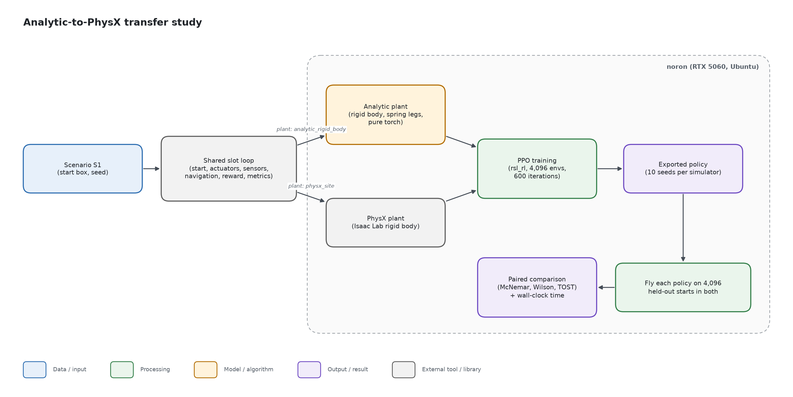
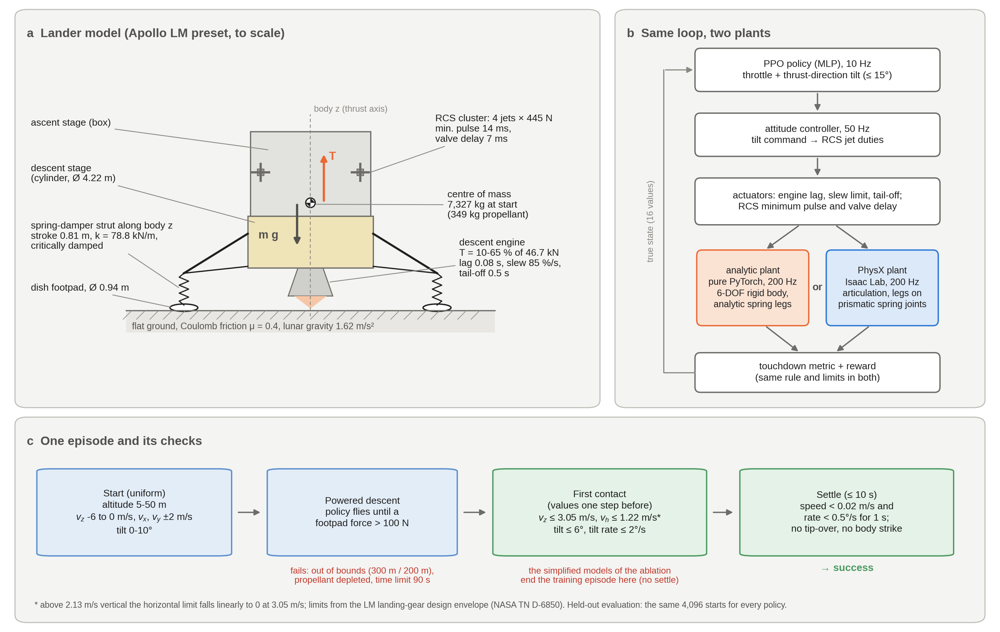
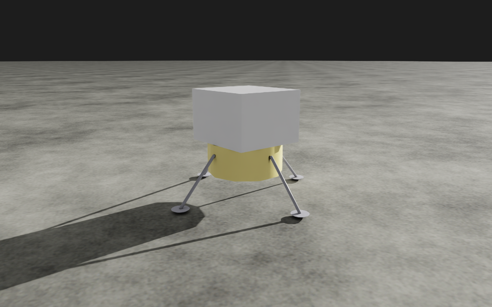
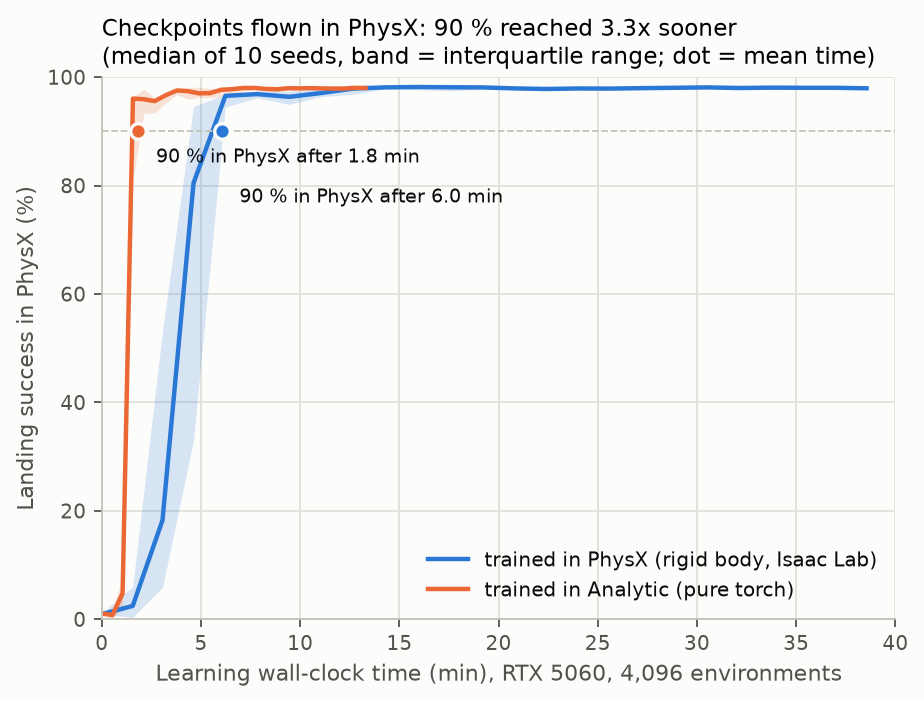
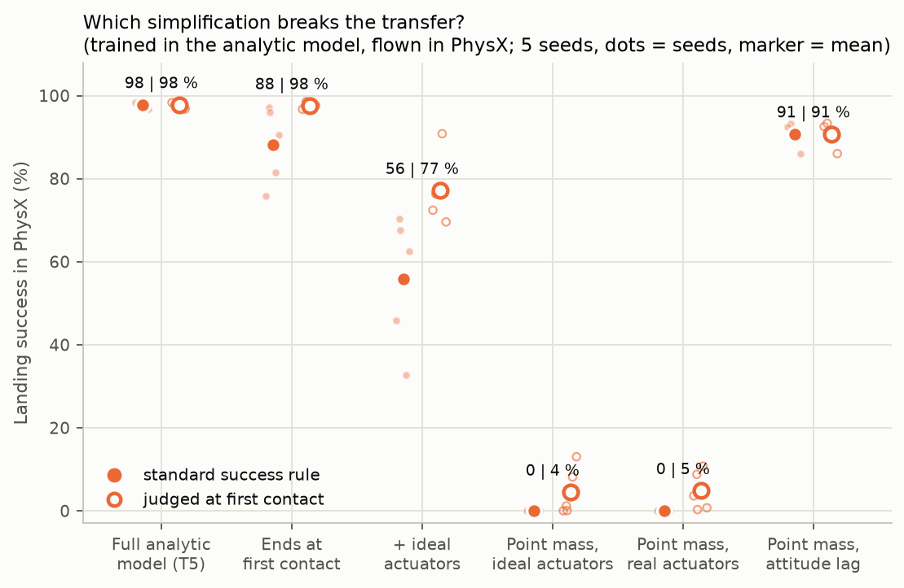
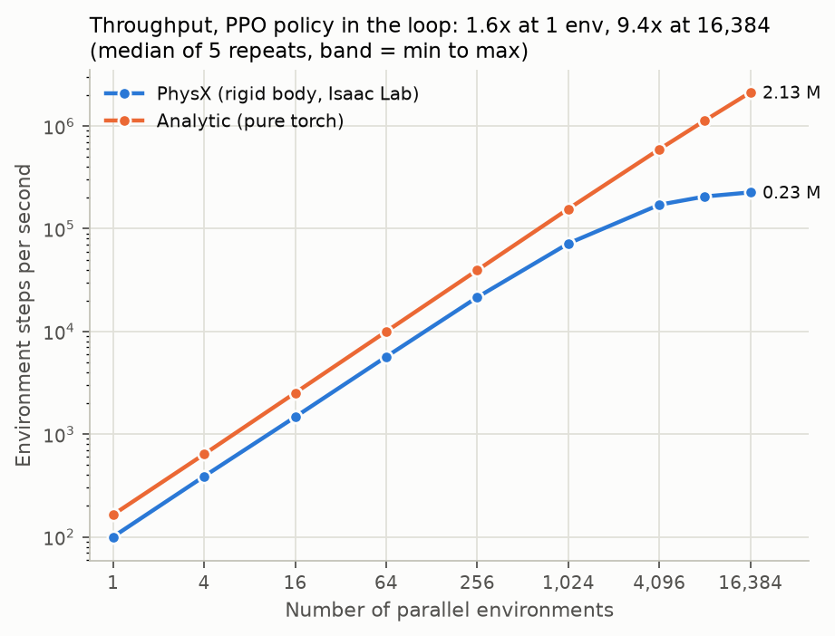

# SpeedVersusFidelityV2

**Can a landing policy trained in a fast analytic simulator land as well in full rigid-body physics, and how much wall-clock time does this save?**

PPO landing policies for an Apollo-class lunar module are trained in two simulators that share everything except the physics: a pure-torch analytic rigid-body model with spring legs, and PhysX rigid-body physics in Isaac Lab.
Each policy is then flown in both simulators on the same 4,096 held-out starts, and a model ablation shows which simplifications of the analytic model break the transfer.
This repository holds the analytic plants, the study scripts, the exported results, the 85 trained policies, the per-start outcomes of every final evaluation and the figures; it replaces an earlier hopper study ([SpeedVersusFidelity](https://github.com/BalBaZeuR0/SpeedVersusFidelity)).


*Left: every 25th training checkpoint flown in PhysX, success against learning wall-clock time (median of 10 seeds; dot = mean time to 90 %). Right: landing success of the 20 final policies in both simulators (dots = seeds; bar = mean and 95 % CI). Data: `results/`.*

## Overview

| | |
|---|---|
| **Problem** | Fast reduced-order simulators could cut RL training time for propulsive landing, but a policy trained in one may fail in full physics. How large is that transfer gap, what is the time saved, and how simple can the fast model be? |
| **Method** | Same scenario (S1 terminal descent), start states, actuators, observation, action, reward and success rule in both simulators; only the plant differs. PPO (rsl_rl), 4,096 environments, 600 iterations, 10 seeds per simulator; each policy flown on 4,096 held-out starts in both simulators; every 25th checkpoint flown in PhysX (time to success in PhysX); a five-step model ablation (5 seeds each, flown in PhysX); paired statistics (McNemar, Wilson, Welch, bootstrap, TOST with a ±1 point margin). |
| **Simulation / hardware** | Isaac Sim 6.0.1, Isaac Lab 24.2.1, PyTorch 2.11.0, rsl-rl-lib 5.4.1, Python 3.12.3; Ubuntu 24.04.4; NVIDIA GeForce RTX 5060 (8 GB). |
| **Paper** | In preparation. |

### System architecture



The scenario and every slot of the loop (start, actuators, sensors, navigation, reward, metrics) come from LunarSim v2 and are the same for both simulators; the plant binding selects the physics (`plant=analytic_rigid_body` or the PhysX plant). PPO trains in either simulator, and each exported policy is flown on the same held-out starts in both. All GPU work ran on one machine, one job at a time, so the wall-clock times are comparable.



*a: the simulated Apollo LM (collision shapes of the model, to scale). b: the shared loop; only the plant differs. c: one episode and its checks. Every number comes from the LunarSim v2 Apollo LM preset and touchdown metric; the limits are the LM landing-gear design envelope (NASA TN D-6850).*



*An analytic-trained policy after landing in PhysX: the last recorded frame of one held-out start, rendered without physics on the flat ground of the scenario (the shapes are the simulator's collision shapes).*

## Selected results

### Result 1: analytic-trained policies land as well in PhysX (no transfer gap)

Over 10 seeds, policies trained in the analytic simulator reach 97.94 % in PhysX, against 97.93 % for policies trained in PhysX itself: a gap of +0.00 points (bootstrap 95 % CI −0.33 to +0.29), equivalent within ±1 point (TOST p < 0.0001). The ±1 point margin was chosen after the runs, about two to four times the seed-to-seed standard deviation (0.25 to 0.47 points). When one policy flies the same start in both simulators, the outcome code is the same for 99.8 % of the starts.


### Result 2: 90 % success in PhysX after 110 s of training instead of 362 s

Every 25th checkpoint of the 20 trainings was flown in PhysX on the held-out starts. Analytic-trained checkpoints reach 90 % success in PhysX after 110 s of learning, PhysX-trained ones after 362 s: about 3× sooner (ratio of the means 3.3, bootstrap 95 % CI over seeds 2.7 to 4.0; 10 of 10 seeds; 2.9× at 50 %, 3.4× at 95 %). The checkpoint grid alone leaves the 90 % ratio between 2.42 and 4.63; the seed interval does not cover this quantisation. Both reach the threshold at about the same PPO iteration (88 and 98), so the saving is the per-iteration speed-up; full training takes 798 s against 2,318 s. Times are those of the first checkpoint at or above the threshold, on a grid of about 33 s (analytic) and 97 s (PhysX).



### Result 3: the analytic model needs attitude dynamics that take time

Policies trained in ever simpler analytic models were flown in PhysX (5 seeds per step). Ending episodes at first contact costs nothing at contact (97.5 % judged at first contact; 88.2 % with the settle check, because these policies hop after touchdown). Ideal actuators drop success to 55.8 % (hard landings). A point mass whose thrust direction follows the command at once fails completely, with ideal actuators (0.0 %) and with the real ones (0.0 %). The same point mass with a first-order attitude lag of 1.3 s, measured on the rigid-body lander's closed-loop tilt response, reaches 90.7 % (95 % CI 87.2 to 94.3).



### Result 4: the analytic simulator scales further with the number of environments

With the PPO policy in the loop, the analytic simulator steps 1.6× faster than PhysX with one environment and 9.4× faster with 16,384 (2.13 million against 0.23 million environment steps per second). PhysX levels off above 4,096 environments on this 8 GB GPU.



*All figures are in `plots/`; the training curves in the training simulator are `plots/training_curves.png`. The classical ZEM/ZEV controller, flown on the same 4,096 starts in both simulators, gives the same outcome code for 99.98 % of the S1 starts and for all starts of a wider range (5 to 150 m, heading 0 to 360°): `results/t3_paired_zem_zev.csv`.*

## Installation

### Requirements

- Python 3.10 or newer (checked with 3.12)
- numpy, pandas, scipy, matplotlib (for the summary and the figures)
- To rerun the simulations: LunarSim v2 ([MEO41/lunarsimv2](https://github.com/MEO41/lunarsimv2), branch `analytic-simulator`, commit `60b1668`; see `NOTICE.md`), Isaac Sim 6.0.1 with Isaac Lab, and an NVIDIA GPU

### Steps

```bash
git clone https://github.com/BalBaZeuR0/SpeedVersusFidelityV2.git
cd SpeedVersusFidelityV2
python3 -m venv .venv && source .venv/bin/activate
pip install -r requirements.txt
python scripts/plot_results.py          # installation check: draws the figures from results/
```

Expected output:

```
wrote plots/t5_transfer_success.png
wrote plots/training_curves.png
wrote plots/t2_throughput.png
wrote plots/t7_success_in_physx.png
wrote plots/t8_model_ablation.png
wrote assets/hero.png
```

## Usage

### Print the study summary from the exported results

```bash
python scripts/summarize_transfer_study.py
```

Expected output (first lines):

```
T5: PPO policies, 10 seeds, each flown on the same 4,096 held-out starts
  trained in physx    flown in physx     97.93 %  sd 0.25  95 % CI 97.75 to 98.12
  trained in physx    flown in analytic  97.94 %  sd 0.26  95 % CI 97.75 to 98.12
  trained in analytic flown in physx     97.94 %  sd 0.47  95 % CI 97.60 to 98.27
  trained in analytic flown in analytic  97.93 %  sd 0.45  95 % CI 97.61 to 98.26
  transfer gap in PhysX (analytic-trained minus PhysX-trained):
    +0.00 points, Welch p = 0.99, bootstrap 95 % CI -0.33 to +0.29, equivalence within +-1 point (TOST) p < 0.0001
  same outcome code when one policy flies the same start in both simulators: analytic-trained 99.84 %, physx-trained 99.81 %
Training (4,096 environments, 600 PPO iterations, RTX 5060):
  physx    total  2318 s, 90 % training success after  403 s (mean of 10 seeds)
  analytic total   798 s, 90 % training success after  128 s (mean of 10 seeds)
T7: checkpoints flown in PhysX, learning time to reach a success rate in PhysX (10 seeds)
   50 %: PhysX-trained  278 s, analytic-trained   97 s, ratio 2.85 (bootstrap 95 % CI 2.32 to 3.51), Welch p < 0.0001
   90 %: PhysX-trained  362 s, analytic-trained  110 s, ratio 3.28 (bootstrap 95 % CI 2.68 to 4.00), Welch p < 0.0001
   95 %: PhysX-trained  411 s, analytic-trained  121 s, ratio 3.41 (bootstrap 95 % CI 2.58 to 4.49), Welch p < 0.0001
T8: trained in simpler analytic models, flown in PhysX (5 seeds); standard rule | judged at first contact
  full analytic model (T5 seeds 0-4)   97.8 % (95 % CI  97.0 to  98.6) |  97.8 % (95 % CI  97.0 to  98.6)
  b1 episode ends at first contact     88.2 % (95 % CI  76.7 to  99.8) |  97.5 % (95 % CI  96.7 to  98.4)
  b2 b1 + ideal actuators              55.8 % (95 % CI  35.9 to  75.8) |  77.1 % (95 % CI  67.0 to  87.3)
  b3 point mass, ideal actuators        0.0 % (95 % CI   0.0 to   0.0) |   4.5 % (95 % CI   0.0 to  11.8)
  b4 point mass, real actuators         0.0 % (95 % CI   0.0 to   0.1) |   4.8 % (95 % CI   0.0 to  10.7)
  b5 point mass, 1.3 s attitude lag    90.7 % (95 % CI  87.2 to  94.3) |  90.8 % (95 % CI  87.2 to  94.3)
```

### Rerun the study (needs LunarSim v2 and Isaac Lab)

The study branch `analytic-simulator` of LunarSim v2 (commit `60b1668`) already contains `src/`, `configs/` and `scripts/noron/` of this repository. Check it out, then on the GPU machine:

```bash
bash scripts/noron/transfer_study_gate.sh            # one seed: train in both simulators, fly each policy in both
bash scripts/noron/transfer_study_seeds.sh           # seeds 1-9
bash scripts/noron/transfer_study_after_gate.sh      # paired ZEM/ZEV flights (T3) and throughput (T2)
bash scripts/noron/transfer_study_t7_checkpoints.sh  # every 25th checkpoint flown in PhysX (T7)
bash scripts/noron/transfer_study_t8_ablation.sh     # model ablation b1-b3 (T8)
bash scripts/noron/transfer_study_t8_lag.sh          # model ablation b4-b5 (T8)
bash scripts/noron/transfer_study_revision_round1.sh # body-rate controls, tau sweep, 10 ms step (T9)
bash scripts/noron/transfer_study_revision_round2.sh # rate hidden from the policy, previous action, refined PhysX (T10)
python scripts/measure_attitude_time_constant.py --tilts 2 5 10 15   # the 1.3 s attitude lag of b5 (CPU)
```

### Fly a trained policy

Each folder in `policies/` holds the final policy of one training (`policy.pt`) and its `manifest.yaml` (command line, seeds, versions, resolved scenario). The held-out flights of the paper used the evaluation command recorded in the manifests of the evaluation runs, for example:

```bash
python scripts/evaluate_agent.py scenario=s1_terminal_truth agent=ppo_mlp num_envs=4096 \
  seed=1000 episodes_per_env=1 logged_envs=256 agent.policy_path=policies/transfer_ppo_physx_seed0/policy.pt
```

(run inside the LunarSim v2 study branch; adding `plant=analytic_rigid_body` flies it in the analytic simulator). Its `episodes.parquet` holds one row per start; the tables of the paper's runs are in `results/per_start/`, named after the evaluation run.

The scripts hold the paths of the study machine; change `REPOSITORY` and the Isaac environment path for another machine. The point-mass steps also need the study branch's changes to LunarSim v2 files (ideal-actuator option, commanded-direction channel; see `NOTICE.md`).

## Reproducing the results

| Figure | Command |
|---|---|
| `plots/t5_transfer_success.png` | `python scripts/plot_results.py` |
| `plots/training_curves.png` | `python scripts/plot_results.py` |
| `plots/t2_throughput.png` | `python scripts/plot_results.py` |
| `plots/t7_success_in_physx.png` | `python scripts/plot_results.py` |
| `plots/t8_model_ablation.png` | `python scripts/plot_results.py` |
| `assets/hero.png` | `python scripts/plot_results.py` |
| `plots/method_overview.png` (and `.pdf`) | `python scripts/draw_method_figure.py` |
| `assets/architecture.png` | `python scripts/flowchart.py assets/architecture.json` |
| `plots/lander_in_physx.png` | rendered with LunarSim v2 (`scripts/render_lander_image.py`) from a recorded PhysX landing; needs LunarSim v2 and Isaac Sim |

The files in `results/` were exported from the training and evaluation runs (`episodes.parquet`, training logs, `checkpoint_wall_clock.csv`, `benchmark.jsonl`). The final policies (`policies/`) and the per-start outcomes of every final evaluation (`results/per_start/`) are in git; the intermediate checkpoints and the recorded trajectories are not.

## Project structure

```
SpeedVersusFidelityV2/
├── assets/            # README images: hero.png, architecture.png (+ .json, .svg)
├── configs/plant/     # analytic_rigid_body.yaml, analytic_point_mass.yaml: model choices of the analytic plants
├── docs/              # study notes: plan and results (T1-T10), analytic model description
├── plots/             # result figures, method overview, lander picture
├── policies/          # 85 final policies (policy.pt + manifest.yaml): 20 main trainings, T8, T9, T10
├── results/           # exported results: T5 success by seed, training curves, T7 checkpoints in PhysX,
│   │                  #   T8 ablation, T2 throughput, T3 paired flights, T9/T10 revision controls in PhysX
│   ├── checkpoint_wall_clock/   # wall-clock time of every training checkpoint (20 runs)
│   └── per_start/     # one row per held-out start for each of the 135 final evaluations
├── scripts/
│   ├── noron/         # job queues run on the GPU machine (gate, seeds, T2/T3, T7, T8, T9, T10)
│   ├── plot_results.py, summarize_transfer_study.py, draw_method_figure.py, flowchart.py
│   └── measure_attitude_time_constant.py   # closed-loop tilt response of the rigid-body lander
├── src/lunarsim/      # files written for this study, at their LunarSim v2 paths
│   ├── slots/plant/analytic_rigid_body.py     # the analytic plant
│   ├── slots/plant/analytic_point_mass.py     # point mass of the ablation (attitude at once or lagged)
│   ├── env/simulator_choice.py                # starts Isaac Sim only for the PhysX plant
│   └── tools/paired_simulator_comparison.py   # Wilson interval, exact McNemar test, outcome table
├── NOTICE.md          # what comes from LunarSim v2 and what is not included
├── LICENSE
├── requirements.txt
└── README.md
```

## Citation, license, contact

```bibtex
@misc{ozkurt2026speedversusfidelityv2,
  title  = {Training lunar landing policies in a fast analytic simulator: transfer to rigid-body physics and wall-clock savings},
  author = {{\"O}zkurt, Cem and Onay, Muhammed Emin and Tun{\c{c}}, Ey{\"u}p Altu{\u{g}} and K{\"u}{\c{c}}{\"u}kler, Ahmet Kutay and {\"O}zt{\"u}rk, Emir},
  year   = {2026},
  howpublished = {\url{https://github.com/BalBaZeuR0/SpeedVersusFidelityV2}}
}
```

BSD 3-Clause License (see `LICENSE`); LunarSim v2 credits in `NOTICE.md`. Contact: [@BalBaZeuR0](https://github.com/BalBaZeuR0), MTA Artificial Intelligence Center.
